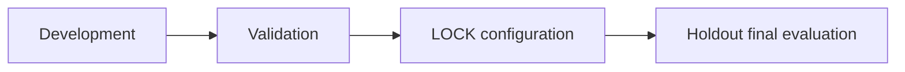

# Jev Control Plane

A small, framework-neutral control plane for agent decisions. Jev returns typed probabilistic evidence; transparent aggregation preserves agreement and conflict; deterministic policy emits `ALLOW`, `DENY`, or `ESCALATE`.

## Architecture


The control plane owns the decision boundary, not the agent's execution lifecycle. Framework adapters and non-Jev decision providers are future work, not V1 dependencies.

## Quick start

Python 3.11 or newer is required. Choose the offline path to try the harness without credentials, or the live path to send a Jev request with your own TypeSafe API key. Both paths require installation from the configured Python package index; only the live path sends inference requests.

### Path A: offline mock (no API key)

Clone the repository and create a virtual environment.

**Windows PowerShell**

```powershell
git clone https://github.com/professionaltarun2004/Jev-Control-Plane.git
cd Jev-Control-Plane
py -3 -m venv .venv
.venv\Scripts\Activate.ps1
```

**macOS / Linux (Bash or Zsh)**

```bash
git clone https://github.com/professionaltarun2004/Jev-Control-Plane.git
cd Jev-Control-Plane
python3 -m venv .venv
source .venv/bin/activate
```

Install the project, run the test suite, then execute the deterministic offline example:

```sh
python -m pip install -e .
python -m unittest discover -s tests -v
python examples/run_mock_experiment.py
```

Installing dependencies requires access to the configured package index. The mock execution itself uses a deterministic local adapter and sends no live Jev request.

The example prints a run ID and artifact directory. Each run is written under `experiments/runs/<run-id>/`:

| File | What to inspect |
| --- | --- |
| `manifest.json` | Run mode, input/configuration digests, and software metadata |
| `summary.json` | Decision counts and supported aggregate metrics |
| `results.jsonl` | One record per attempted Development case, including raw control-plane evidence |

Use the printed directory to inspect the files. For example, `python -m json.tool experiments/runs/<run-id>/summary.json` formats the summary; open `results.jsonl` as text to inspect the individual records. A new run directory is retained as an experiment artifact and may appear as an untracked path in `git status`.

These outputs are labeled `mock`. The current eight-case synthetic Development run has 5 matching final actions, 3 mismatches, 8 escalations, and 0 runner errors. These are mock plumbing results, not Jev performance, live effectiveness, agent-task outcomes, or research findings. The example uses only the Development split. The tests use temporary split/lock fixtures; they do not evaluate repository Holdout data or make live Jev requests. A failing test prints its traceback and exits nonzero.

### Path B: live Jev example (your own API key)

Follow the [official TypeSafe quick start](https://docs.typesafe.ai/introduction/quickstart.md) and [Python SDK guide](https://docs.typesafe.ai/sdk/python.md) to obtain access and create your own API key. Keep the key private. The SDK reads `TYPESAFE_API_KEY` from the process environment; this repository does not automatically load `.env` files. The root [`.env.example`](.env.example) is a placeholder template only. Copying it to `.env` does not configure the SDK, and `.env` must never be committed.

Set the key in the terminal where you will run the example.

**Windows PowerShell**

```powershell
$secureKey = Read-Host "TypeSafe API key" -AsSecureString
$env:TYPESAFE_API_KEY = [System.Net.NetworkCredential]::new("", $secureKey).Password
python examples/decision_flow.py
Remove-Item Env:TYPESAFE_API_KEY
$secureKey.Dispose()
```

**macOS / Linux**

```sh
IFS= read -r -s -p "TypeSafe API key: " TYPESAFE_API_KEY
printf '\n'
export TYPESAFE_API_KEY
python examples/decision_flow.py
unset TYPESAFE_API_KEY
```

The key is read without echoing it to the terminal or putting it in the command history. Do not paste keys into chat, source files, or commits. The example sends a real request to Jev and may incur usage or charges under your provider account and terms; check the provider for current details.

If the SDK is missing, the adapter reports that the official SDK must be installed. If client initialization fails (including missing or locally invalid key configuration), the adapter raises a `RuntimeError` asking you to configure a valid `TYPESAFE_API_KEY`. Errors returned during a live request are surfaced by the SDK; the example does not convert them into a custom message. Live Jev performance has not been measured.

### Troubleshooting

- If PowerShell blocks virtual-environment activation, run the environment's interpreter directly: `.venv\Scripts\python.exe -m pip install -e .`, then use `.venv\Scripts\python.exe` in place of `python` for the test and example commands. This avoids changing the machine's execution policy.
- If `py` is unavailable, install Python 3.11 or newer and use `python -m venv .venv` in PowerShell.
- If the SDK import fails on the live path, activate the project environment and rerun `python -m pip install -e .`.
- If the live adapter reports that it could not initialize TypeSafe Jev, confirm the key was entered in the same terminal session and retry with a valid key. Authentication or request errors returned after initialization are reported by the SDK.

## Failure Lab

The benchmark's primary unit is one decision. Cases store only the decision state/question and expected final action with ground-truth provenance; perturbation annotations are separate. The current Development cases use developer-authored synthetic rules. Their labels are independent of Jev outputs, but have not been independently validated and do not establish real-world validity. The runner executes the Jev path only, in live TypeSafe or explicitly labeled deterministic mock mode.



The Holdout runner requires a write-once configuration lock created from a completed Validation run. Split folders and local digests reduce accidental tuning leakage; they do not establish benchmark representativeness or statistical validity. Validation and Holdout are currently unpopulated.

## Results

**Live Jev performance: Not measured yet.** The included Development data is small and synthetic. Mock output exists only to test dataset loading, the existing policy loop, failure retention, metrics, and artifact generation. No comparative, calibration, safety, or speed claims are made.

## Research and contributor notes

- [Authoritative experimental protocol](EXPERIMENT_PROTOCOL.md)
- [Failure Lab run guide](experiments/README.md)
- [Dataset schema and split layout](experiments/datasets/README.md)
- [Ground-truth construction rules](experiments/datasets/ground_truth_rules.md)
- [Project specification](SPEC.md)
- [M3A decision proposal and open owner decisions](M3A_DECISION_PROPOSAL.md)
- [M3 validation design specification](M3_VALIDATION_SPEC.md)
- [Milestone tasks and evidence trail](.genesis/PLAN.md)

To contribute, start with [CONTRIBUTING.md](CONTRIBUTING.md). Report vulnerabilities using [SECURITY.md](SECURITY.md), not a public issue. The project follows its [Code of Conduct](CODE_OF_CONDUCT.md).

The Noul API exposes a yes probability without a separate confidence field. The adapter preserves that distinction. Current runtime policy defaults are legacy experimental behavior, not approved M3A criteria; the primary Jev condition, evidence mappings and aggregation, thresholds, and acceptance criteria remain open in [M3_VALIDATION_SPEC.md](M3_VALIDATION_SPEC.md).

## Repository map

| Path | Purpose |
| --- | --- |
| `src/jev_control_plane/` | Typed decision flow, Jev adapter, evidence aggregation, deterministic policy, records, and Failure Lab. |
| `tests/` | Offline unit tests for the control plane, split/lock protections, runners, and comparison artifacts. |
| `examples/` | Offline mock runs and the credential-dependent live Jev example. |
| `experiments/configs/` | Versioned experiment configurations. |
| `experiments/datasets/` | Development cases and annotations; Validation and Holdout are not populated. |
| `experiments/runs/` and `experiments/comparisons/runs/` | Local generated artifacts; new runs are ignored by default. |
| `SPEC.md` | Engineering requirements and milestone acceptance criteria. |
| `EXPERIMENT_PROTOCOL.md` | Authoritative research methodology and split discipline. |
| `M3_VALIDATION_SPEC.md` and `M3A_DECISION_PROPOSAL.md` | Draft Validation contract and unresolved M3A owner decisions. |
| `.genesis/` | Engineering plan, project state, and verification evidence; not a runtime dependency. |

## License status

No license has been selected or included. Until the maintainer chooses one, the repository does not grant general permission to reuse or redistribute its contents. See [GitHub's licensing guidance](https://docs.github.com/en/repositories/managing-your-repositorys-settings-and-features/customizing-your-repository/licensing-a-repository) for common options; do not assume a permissive license applies.
