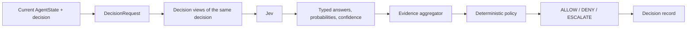
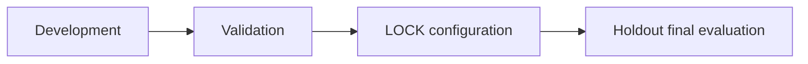

# Jev Control Plane

A small, framework-neutral control plane for agent decisions. Jev returns typed probabilistic evidence; transparent aggregation preserves agreement and conflict; deterministic policy emits `ALLOW`, `DENY`, or `ESCALATE`.

## Architecture



The control plane owns the decision boundary, not the agent's execution lifecycle. Framework adapters and non-Jev decision providers are future work, not V1 dependencies.

## Quick start: offline mock path

Python 3.11 or newer is required. The mock example needs no Jev credentials or inference request. Installing dependencies requires access to the configured Python package index; after installation, the example uses a deterministic local adapter instead of contacting Jev.

Clone the repository, then create and activate a virtual environment.

**Windows PowerShell**

```powershell
git clone https://github.com/professionaltarun2004/Jev-Control-Plane.git
cd Jev-Control-Plane
py -3 -m venv .venv
.venv\Scripts\Activate.ps1
```

**macOS / Linux**

```sh
git clone https://github.com/professionaltarun2004/Jev-Control-Plane.git
cd Jev-Control-Plane
python3 -m venv .venv
source .venv/bin/activate
```

Install the project and its declared dependencies, then run the offline example:

```sh
python -m pip install -e .
python examples/run_mock_experiment.py
```

The example prints the run ID and artifact directory. Each run is written under `experiments/runs/<run-id>/`:

| File | What to inspect |
| --- | --- |
| `manifest.json` | Run mode, input/configuration digests, and software metadata |
| `summary.json` | Decision counts and supported aggregate metrics |
| `results.jsonl` | One record per attempted Development case, including raw control-plane evidence |

Use the printed directory to inspect the files. For example, `python -m json.tool experiments/runs/<run-id>/summary.json` formats the summary; open `results.jsonl` as text to inspect the individual records. A new run directory is retained as an experiment artifact and may appear as an untracked path in `git status`.

These outputs are labeled `mock`. They verify the local dataset-to-runner-to-policy-to-artifact path only; they are not Jev performance, agent task outcomes, or research findings. The example runs only the Development split.

## Tests

Run the standard-library test suite from the repository root:

```sh
python -m unittest discover -s tests -v
```

The command prints each test and its traceback on failure and exits nonzero if a test fails. The tests include temporary split/lock fixtures; they do not evaluate the repository's Holdout dataset or make live Jev requests.

## Live Jev example

The separate control-loop example sends a real request and requires a valid `TYPESAFE_API_KEY`. Do not use it to verify the offline mock setup. Live Jev performance has not been measured.

```sh
python examples/decision_flow.py
```

## Failure Lab

The benchmark's primary unit is one decision. Cases store only the decision state/question and expected final action with ground-truth provenance; perturbation annotations are separate. The current Development cases use developer-authored synthetic rules. Their labels are independent of Jev outputs, but have not been independently validated and do not establish real-world validity. The runner executes the Jev path only, in live TypeSafe or explicitly labeled deterministic mock mode.



The Holdout runner requires a write-once configuration lock created from a completed Validation run. Split folders and local digests reduce accidental tuning leakage; they do not establish benchmark representativeness or statistical validity. Validation and Holdout are currently unpopulated.

## Results

**Live Jev performance: Not measured yet.** The included Development data is small and synthetic. Mock output exists only to test dataset loading, the existing policy loop, failure retention, metrics, and artifact generation. No comparative, calibration, safety, or speed claims are made.

## Research and contributor notes

- [Authoritative experimental protocol](EXPERIMENT_PROTOCOL.md)
- [Failure Lab run guide](experiments/README.md)
- [Dataset schema and split layout](experiments/datasets/README.md)
- [Ground-truth construction rules](experiments/datasets/ground_truth_rules.md)
- [Project specification](SPEC.md)
- [Milestone tasks and evidence trail](.genesis/PLAN.md)

The Noul API exposes a yes probability without a separate confidence field. The adapter preserves that distinction; policy thresholds are experimental defaults and must be selected on Validation, then frozen before Holdout.
